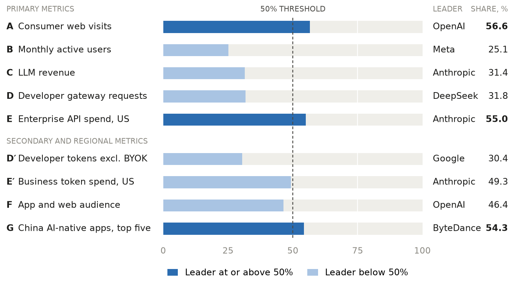
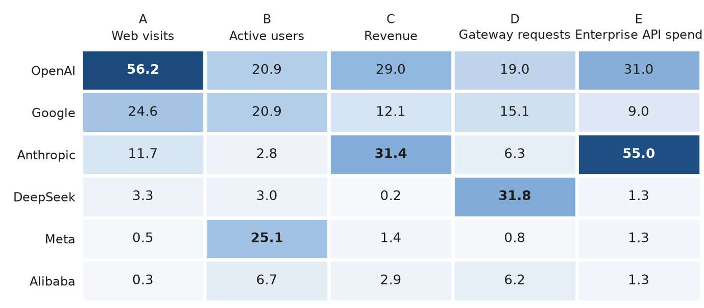
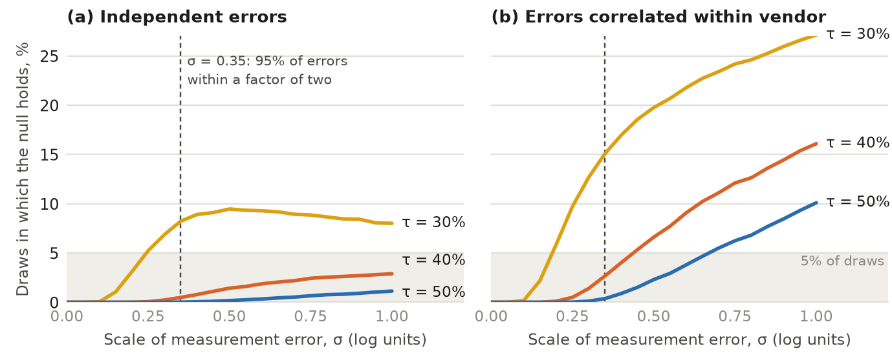
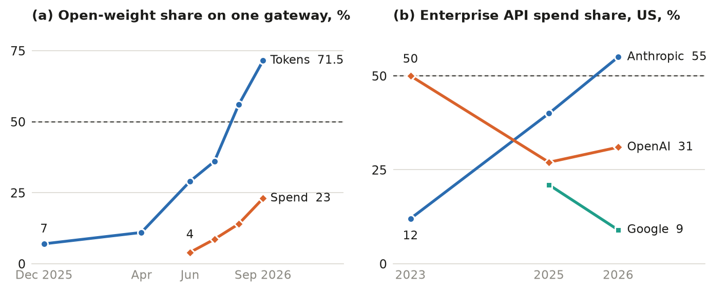
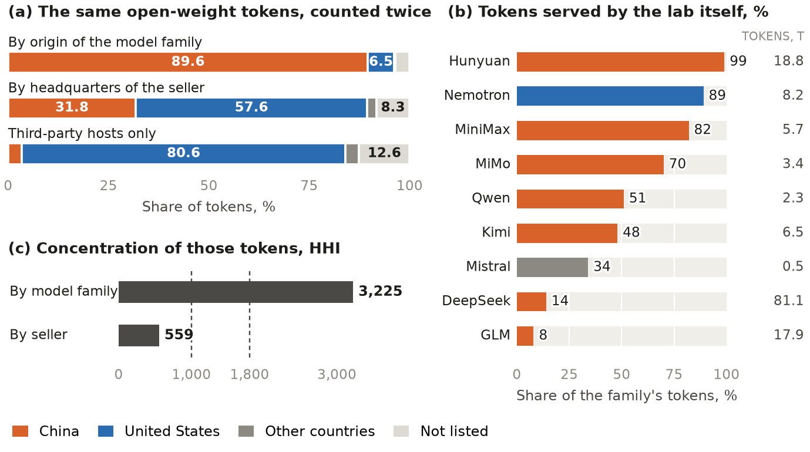

# No Universal AI Dominance

**A multi-dimensional falsification test of vendor, paradigm and origin dominance in global LLM adoption.**

Replication package for the paper by [Rodrigo F. A. P. Oliveira](mailto:rfapo@cesar.school) (CESAR School, Recife, Brazil), November 2026.

📄 **[Read the paper](paper/no-universal-ai-dominance.pdf)** · 🔬 [Reproduce in ~90 seconds](#reproducing-the-paper) · 📊 [Results](results/results.json)

---

## The question

Three claims of dominance circulate about large language models: that one **vendor** owns the market (usually OpenAI), that one **paradigm** has won (closed or open weights), and that one **country of origin** dominates global use (the US or China). Each is usually supported by a single metric — and the metrics disagree.

Web-traffic studies find ChatGPT with 77% of visits to the top 60 generative AI tools. Gateway telemetry finds open-weight models from Chinese labs processing most tokens. Spend data find a third ranking, led by Anthropic. These findings are compatible only if "dominance" depends on what is counted.

So the paper asks a narrow question: **is there any definition-robust dominance in LLM adoption?**

## The design: dominance as the null hypothesis

The usual practice makes "no effect" the null, so a failure to detect dominance is uninformative. This paper **reverses the burden of proof**, as in equivalence testing: dominance is the null, and the data must be shown to be incompatible with it.

$$H_0(\tau):\ \exists\, v\ \ \forall\, d \in \{A,\dots,E\}:\ s_{v,d} \ge \tau \qquad\text{(universal dominance)}$$

$$H_1(\tau):\ \forall\, v\ \ \exists\, d:\ s_{v,d} < \tau \qquad\text{(no universal dominance)}$$

where $s_{v,d}$ is entity $v$'s share in dimension $d$ and $\tau$ is a dominance threshold taken from competition law ($\tau = 50\%$ primary, following EU case law; 40% and 30% as sensitivity).

This is a **union–intersection** structure (Roy 1953): $H_0$ for a given vendor is an intersection of five component statements, so it falls when any one falls; because the union over vendors is taken afterwards, $H_0$ is rejected only if it fails for *every* vendor. The pooled test is an **intersection–union test** (Berger 1982), which needs no multiplicity correction.

### Five adoption dimensions, different units and populations

| | Dimension | Unit | Primary source |
|---|---|---|---|
| **A** | Consumer attention | web visits | Similarweb panel, Oct 2026 |
| **B** | User base | monthly active users | Counterpoint estimate, Apr 2026 |
| **C** | Revenue | US dollars | Counterpoint estimate, Q1 2026 |
| **D** | Developer volume | gateway requests / tokens | OpenRouter telemetry, Nov 2026 |
| **E** | Enterprise spend | US dollars of API spend | Menlo survey, 2026 |

Plus independent secondary metrics (D′ tokens excluding BYOK, E′ business card spend, F app+web audience) and one regional metric (G, Chinese AI-native apps). Nine share metrics in all, over **61 data sources and 53 scholarly works**.

The test runs at three levels of aggregation — **vendor**, **paradigm** (closed vs. open weights) and **origin** (US- vs. China-origin labs) — and inside four candidate relevant markets (M1 consumer assistants outside China, M2 enterprise model spend, M3 developer inference through gateways, M4 consumer AI apps in China).

---

## Headline results

### 1. The identity of the leader changes with the unit of measurement



| | Leader | $s_{(1)}$ | $s_{(1)}/s_{(2)}$ | CR4 | HHI (bounds) | Local $H_0(50)$ |
|---|---|---:|---:|---:|---|---|
| A | OpenAI | 56.6 | 2.29 | 96.5 | 3,968 | not rejected |
| B | Meta | 25.1 | 1.20 | 74.0 | 1,627–1,661 | **rejected** |
| C | Anthropic | 31.4 | 1.08 | 79.7 | 2,075 | rejected |
| D | DeepSeek | 31.8 | 1.67 | 72.9 | 1,742–1,755 | rejected |
| E | Anthropic | 55.0 | 1.77 | 95.0 | 4,067–4,092 | not rejected |
| D′ | Google | 30.4 | 1.35 | 72.8 | 1,739–1,744 | rejected |
| E′ | Anthropic | 49.3 | 1.07 | 99.5 | 4,564–4,565 | rejected (marginal) |
| F | OpenAI | 46.4 | 1.68 | 84.4 | 3,026–3,161 | rejected |
| G | ByteDance | 54.3 | 2.65 | 95.5 | 3,663 | not rejected |

Nine metrics, **six different leaders**. Every metric is at least moderately concentrated and **six of nine exceed an HHI of 1,800**. Under the error model the one-dimensional test rejects only when the leader holds less than 28.1%, which happens in exactly one metric (B).

### 2. No vendor reaches 50% in more than one of five dimensions



| | A | B | C | D | E | $\min_d$ | $\kappa(50)$ | dims ≥ 50 |
|---|---:|---:|---:|---:|---:|---:|---:|---:|
| OpenAI | **56.2** | 20.9 | 29.0 | 19.0 | 31.0 | 19.0 | 2.6 | 1 |
| Google | 24.6 | 20.9 | 12.1 | 15.1 | 9.0 | 9.0 | 5.6 | 0 |
| Anthropic | 11.7 | 2.8 | **31.4** | 6.3 | **55.0** | 2.8 | 17.9 | 1 |
| DeepSeek | 3.3 | 3.0 | 0.2 | **31.8** | 1.3 | 0.2 | 250 | 0 |
| Meta | 0.5 | **25.1** | 1.4 | 0.8 | 1.3 | 0.5 | 100 | 0 |
| Alibaba | 0.3 | 6.7 | 2.9 | 6.2 | 1.3 | 0.3 | 161 | 0 |

Universal dominance would appear as one uniformly dark row. Four distinct vendors lead the five dimensions; restricting attention to robust leads (lead ratio ≥ 1.5) still leaves three different leaders. $\kappa_v(50) > 2$ for every vendor, so rescuing the null would require a measurement error larger than a factor of two everywhere.

### 3. The calibrated pooled test

$T_v(\tau) = \sum_d \max\{0, \ln(\tau/s_{v,d})\}$ is the total log-shortfall below the threshold. Under the multiplicative log-normal error model, $T_v$ is stochastically largest within $H_0$ when every true share equals $\tau$, so the tail probability computed at that point is a valid $p$-value.

| Specification | $\tau$ | $p$ (independent errors) | $p$ (correlated, $\rho = 0.5$) |
|---|---:|---:|---:|
| Primary matrix | 50 | **0.0002** | **0.018** |
| Primary matrix | 40 | **0.010** | 0.076 |
| Primary matrix | 30 | 0.33 | 0.32 |
| Most favourable to $H_0$ | 50 | 0.074 | 0.161 |
| Most favourable to $H_0$ | 40 | 0.30 | 0.30 |

**On single-source data, $H_0(50)$ is rejected.** The rejection survives any error scale up to $\sigma = 0.65$ with independent errors (95% of errors within a factor of 3.6) and up to $\sigma = 0.45$ with correlated errors (a factor of 2.4).



### 4. Where the null is *not* rejected — reported with equal weight

A title like this one is easy to over-read. The paper is explicit about the limits of its own result, and so is this README:

- **The most favourable reading.** Taking the *largest* share reported by any source in every cell, $p$ rises to **0.07–0.16** and the rejection fails. The conclusion depends on three specific source choices.
- **Ownership blocs.** If, on that reading, Google and Anthropic are counted as one bloc (Google holds 13.7% of Anthropic), a **30% threshold is met in all five dimensions**.
- **At $\tau = 30\%$.** The data cannot exclude that OpenAI holds a substantial share everywhere. The paper's claim is specific to dominance in the legal sense of a majority or near-majority.
- **Paradigm and origin are asymmetric.** Dominance by *open weights* and by *Chinese labs* is rejected; dominance by *closed weights* and by *US labs* is **not** — their shares fall below 50% only in gateway tokens and open-model downloads, by less than the error tolerance.
- **High concentration is not refuted.** HHI exceeds 1,800 in six of nine metrics. The data do not support the looser claim that the LLM market is unconcentrated.
- **Local dominances exist.** Consumer assistants outside China (OpenAI at 46–79% across four readings, above 50% in all 13 months of the panel) and enterprise model spend (a leader at 49–59% in five sources, which disagree on whether it is Anthropic or OpenAI).
- **Upstream is a different market.** In AI accelerators one firm holds **75–86%**, a share that clears every threshold used in the paper. Nothing here extends to chips, cloud capacity or training compute.

### 5. Persistence separates the markets



Over a thirteen-month panel, the consumer leader held ≥ 50% in **all 13 months** (while losing 19 points), with an instability index of 2.9% of the market changing hands per month. Developer inference had **three leaders in 13 months** and an instability index of 19.4% — nearly seven times higher. Durability, an element of any dominance assessment, points in opposite directions in the two markets.

### 6. Inside the open-weight segment, the author of a model is not the seller of its tokens



Because anyone can serve released weights, the two counts give different answers. Chinese families supply **89.6%** of open-weight gateway tokens, while **57.6%** of those tokens are sold by US-headquartered firms. Only 34.7% are served by the lab that released the weights. Attributing tokens to the seller instead of the author collapses the HHI from **3,225 to 559** — from highly concentrated to unconcentrated, on the same data.

---

## What this means

> A claim of dominance should name its unit, its market and its source.

The picture that fits all nine metrics is **a set of segments, each with a different leader and each highly concentrated**: OpenAI in consumer attention; Meta, OpenAI and Google close together in reach; Anthropic in enterprise spend on four of five sources; DeepSeek, Google or OpenAI in developer volume according to the unit; ByteDance in China on one of two panels. Which of these one calls "the market" determines who appears dominant.

Three implications. **For measurement**, token share should not be read as market share: it moved by tens of points within a quarter under price promotions, and differs from spend share by exactly the price gap (~7×). **For policy**, the relevant antitrust question is segment-specific — the evidence is strongest for consumer chat outside China and for enterprise APIs, weakest for developer inference. **For diffusion**, the sharper divide is between populations, not vendors: adoption in the Global North runs 12.6 points above the Global South, and inside Brazil the gap between the top and bottom income classes is 53 points. On that axis no vendor's share matters as much as who is using any model at all.

---

## Repository layout

```
├── paper/
│   ├── main.tex                     # manuscript source (LaTeX, natbib)
│   ├── references.bib               # 126 bibliography entries
│   ├── main.bbl                     # compiled bibliography
│   ├── no-universal-ai-dominance.pdf
│   └── figs/                        # 14 figures, PDF (for LaTeX) and PNG (for this README)
├── code/
│   ├── analysis.py                  # every transcribed input + every statistic → results.json
│   ├── validate_stats.py            # independent re-implementation of each procedure
│   ├── figures.py                   # the 14 figures
│   ├── archive_urls.sh              # requests an Internet Archive snapshot of every source URL
│   └── paths.py                     # input/output locations (the only file added to the arXiv ancillary set)
├── data/
│   └── sources.csv                  # bib key, title, URL and access date of every data source
├── results/
│   ├── results.json                 # all computed statistics (the paper's single source of truth)
│   └── validation.json              # the independent re-implementation's comparison report
├── tests/
│   └── test_paper_claims.py         # 77 tests: every number in the paper vs. results.json
├── .github/workflows/reproduce.yml  # CI: re-runs the analysis and diffs the committed outputs
├── Makefile
├── requirements.txt
├── CITATION.cff
├── LICENSE                          # MIT, for code/ and tests/
└── LICENSE-CC-BY-4.0                # CC BY 4.0, for paper/, data/ and results/
```

**The data are secondary throughout.** There is no raw dataset to ship: every input is a published share transcribed from a cited source, and all of them live inline in `code/analysis.py` next to the citation they came from. `data/sources.csv` carries the URL behind each one.

---

## Reproducing the paper

```bash
git clone https://github.com/rfapo/no-universal-ai-dominance
cd no-universal-ai-dominance
python3 -m venv .venv && source .venv/bin/activate
pip install -r requirements.txt

make all          # analysis + validation + figures + tests  (~90 s)
```

Or step by step:

```bash
make analysis     # code/analysis.py      → results/results.json      (~70 s)
make validate     # code/validate_stats.py → results/validation.json   (~4 s)
make figures      # code/figures.py        → paper/figs/*.{pdf,png}     (~5 s)
make test         # pytest tests/                                       (<1 s)
make paper        # LaTeX → paper/no-universal-ai-dominance.pdf
make verify       # assert results/ and figures are unchanged by a fresh run
make verify-strict # same, but the figures must match byte for byte

make archive-status # which cited URLs lack a Wayback snapshot, or have a stale one
make archive        # request a snapshot of every cited URL (needs web.archive.org)
```

### What reproduces, and how exactly

Every simulation takes an explicit seed, and the two artefacts have different guarantees — worth stating precisely rather than claiming more than holds:

| Artefact | Guarantee | Checked by |
|---|---|---|
| `results/results.json`, `results/validation.json` | **Byte-identical on any platform.** NumPy's PCG64 stream is versioned and stable across releases, so the statistics do not depend on the host. Confirmed on Linux by CI against results produced on macOS. | `make verify` (hard fail) |
| `paper/figs/*.png`, `*.pdf` | **Produced at the reference dimensions.** PNG bytes are a function of the Matplotlib, Pillow and FreeType versions and of the host's fonts, so byte equality is not a cross-platform invariant for a rendering. | `make verify` (hard fail on missing, truncated or resized; pixel differences measured and reported) |
| `paper/figs/*.png` | **Byte-identical** between runs sharing a font stack. | `make verify-strict` (hard fail) |

`make verify` reruns the whole pipeline into a scratch directory and compares. It deliberately does not fail the build when a figure merely re-rasterises, because any pixel threshold loose enough to absorb re-rendered text is also loose enough to absorb a genuinely changed bar — so the check is structural, and `verify-strict` is there for the exact-bytes question.

Runtime is dominated by the permutation test (200,000 within-dimension permutations) and the simulations (100,000 draws per $\sigma$ for the error curves; 400,000 to 2,000,000 for the pooled null distributions).

### Building the PDF

The manuscript compiles with any TeX distribution. The committed PDF was built with [Tectonic](https://tectonic-typesetting.github.io/):

```bash
cd paper && tectonic -X compile main.tex
```

`make paper` prefers `latexmk`/`pdflatex` when available and falls back to `tectonic`. Float placement differs slightly between engines, so page numbers may shift by one; the content does not.

---

## Statistical methods

The published shares are point estimates from panels, telemetry and surveys with **no usable sampling distribution**. The design therefore states tolerance-based decision rules and adds two model-based quantities. All ten rules are implemented in `code/analysis.py` and independently re-implemented in `code/validate_stats.py`.

| Rule | Procedure | Implementation |
|---|---|---|
| 1 | **Concentration** — leader's share, lead ratio, CR4, HHI with explicit bounds when a residual "others" share is unattributed (lower: residual atomistic; upper: split into blocks no larger than the smallest named share) | `hhi_bounds`, `cr` |
| 2 | **Robustness margin** — $\kappa_v(\tau) = \tau / \min_d s_{v,d}$, the factor by which the weakest share must be understated for $H_0$ to hold. Reject when $\kappa_v > \kappa^* = 2$; inconclusive when $1 < \kappa_v \le 2$ | `out["robustness"]` |
| 3 | **Most-favourable sensitivity** — rule 2 on a matrix taking the largest share reported by any source per cell | `out["favourable"]` |
| 4 | **Leader identity** — count of distinct leaders, separating robust (lead ratio ≥ 1.5) from fragile leads | `out["leaders_primary"]` |
| 5 | **Rank concordance** — Kendall's $W$, tie-corrected, with a 200,000-permutation $p$-value (descriptive only) | `kendall_w`, `w_test` |
| 6 | **Measurement-error simulation** — each share multiplied by $e^\varepsilon$, $\varepsilon \sim N(0,\sigma^2)$, 100,000 draws per $\sigma \in [0,1]$, under independent and within-vendor correlated ($\rho = 0.5$) errors. Shares capped at 100 and not renormalised, which favours $H_0$ | `mc_h0` |
| 7 | **Calibrated pooled test** — $T_v(\tau) = \sum_d \max\{0, \ln(\tau/s_{v,d})\}$, evaluated at the least favourable point of $H_0$ (all true shares $= \tau$), 400,000 draws. Intersection–union over vendors, no multiplicity correction | `p_pooled`, `p_T`, `p_local` |
| 8 | **Ownership blocs** — the test repeated with equity-linked vendors as one entity; HHI adjusted for partial ownership after O'Brien & Salop ($\beta s_j s_k$ for a silent interest, $2 s_j s_k$ for a full merger) | `bloc`, `mhhi` |
| 9 | **Durability** — months with the leader above $\tau$, leader changes, and the Hymer–Pashigian instability index (half the sum of absolute monthly share changes, residual counted as one entity) | `panel_stats` |
| 10 | **Unit and denominator checks** — dimension D recomputed by seller rather than model author; all five dimensions renormalised over a common denominator | `d_by_seller`, `common_denominator` |

### Why the error model is declared, not estimated

$\sigma = 0.35$ is a *choice*, set so that 95% of multiplicative errors fall within a factor of two. It is not estimated from data, because no publisher reports uncertainty on these shares. The paper therefore reports the whole curve $\sigma \in [0,1]$ rather than a single number, and states the largest $\sigma$ at which each rejection survives. The rules were fixed after the data had been collected and inspected; **the study was not preregistered**, and it is not presented as a confirmatory protocol. The thresholds (50/40/30) come from competition law and predate the study.

### What `validate_stats.py` checks

Not a re-run — a re-derivation by a different route, with a different seed and larger simulations:

- Kendall's $W$ via the **Friedman statistic**, $W = \chi^2_F / (k(n-1))$, against the direct computation.
- The pooled test's **size at the boundary** of $H_0$ (must be ≤ α: measured 0.0497 and 0.0498), **inside** $H_0$ (0.0033), at a mixed boundary point (0.0019), and its **power** against the observed configuration (0.984).
- Rule 2's analytic false-rejection rate against simulation (0.1136 vs. 0.1136).
- The **HHI upper bound** against a 200,000-draw brute-force search over admissible splits of the unattributed residual (1,854 vs. 1,851 — the bound holds and is tight).
- The partial-ownership HHI through the **general MHHI formula** rather than the closed form (39.34 vs. 39.34).
- The instability index with the unlisted residual treated as one entity, so shares sum to 100.
- **Exact permutation** $p$-values for the open-weight Spearman correlations ($n = 6$, all 720 permutations).
- The Monte Carlo standard error of the smallest reported $p$-value (7 × 10⁻⁶ against $p = 0.00016$).

### The test suite

`tests/test_paper_claims.py` holds 77 tests. Each asserts a value that appears in a table, a figure caption or a sentence of `paper/main.tex` against `results/results.json`, so the manuscript cannot silently drift from the code. It also checks structural properties that must hold for the statistics to be valid at all — HHI bounds ordered, $W \in [0,1]$, the Monte Carlo curve increasing in $\sigma$, merging vendors never making the null harder to satisfy, and OpenAI being the binding vendor of the union–intersection test in every specification.

---

## Data provenance and its limits

Every source was read in **November 2026**. Several are live dashboards that are overwritten weekly or monthly, so **the figures cannot be recovered from the URL alone**. `data/sources.csv` lists 63 source URLs — the 61 data sources counted in the paper plus the ownership disclosures used in the bloc scenarios. `make archive` requests an Internet Archive snapshot of each, and `make archive-status` reports which URLs still need one.

A snapshot is not merely *present* or *absent*: a snapshot taken before the month a source was read does not show the figures the paper reports, because these pages are overwritten. `make archive-status` therefore separates **missing** from **stale** and compares each snapshot against the `accessed` column of `data/sources.csv`. Note that `make archive` needs `web.archive.org`, which some networks block at the TCP level even when `archive.org` itself is reachable; the script preflights that host and exits immediately with an explanation rather than stalling for hours.

Known limits, stated in the paper and repeated here:

- **Selection.** The study started from five leaderboards and market-share pages chosen by the author — a convenience sample. Sources were then added until each of ten gap and counterfactual questions had an independent source, and each claim used in a test was required to appear in at least two sources of different type (telemetry, panel, survey, disclosure) where such sources exist.
- **Publisher interest.** Several sources have a stake in the result: Menlo Ventures invests in Anthropic, a16z in OpenAI, and OpenRouter publishes telemetry about its own platform. These are flagged per metric in the paper's data table and in the market-level table.
- **Truncated denominators.** Metrics A, F and G are computed over a truncated set of assistants, which biases their HHI upward relative to the full market.
- **No deduplication.** MAU figures include embedded assistants and are not deduplicated across products; the sum across vendors exceeds the plausible number of distinct users.
- **Self-hosted inference is invisible.** Gateway telemetry covers a small fraction of total inference (OpenRouter runs ~6% of the volume of the sum of the largest first-party APIs), and no publisher reports volumes for locally served weights.

The paper's own next step: *a preregistered replication on a fixed monthly panel, with the assumed error model replaced by estimated uncertainty* — which needs what no publisher currently provides: deduplicated users, tokens by country of user, and volumes for self-hosted inference.

---

## Citation

```bibtex
@article{oliveira2026nodominance,
  author  = {Oliveira, Rodrigo F. A. P.},
  title   = {{No Universal AI Dominance}: A Multi-Dimensional Falsification Test
             of Vendor, Paradigm and Origin Dominance in Global LLM Adoption},
  year    = {2026},
  month   = {November}
}

@misc{oliveira2026repo,
  author       = {Oliveira, Rodrigo F. A. P.},
  title        = {{No Universal AI Dominance}: replication package (transcribed inputs,
                  analysis code, statistical validation and figures)},
  year         = {2026},
  howpublished = {\url{https://github.com/rfapo/no-universal-ai-dominance}},
  note         = {Version 1.0}
}
```

## AI assistance and competing interests

Source discovery and literature searches were run by the author on four AI assistants from different vendors and countries of origin (DeepSeek, Qwen, Gemini and Claude), so that the selection of sources would not depend on a single model. The analysis scripts and the draft of the manuscript were produced with Claude (Anthropic). **The four vendors are among those analysed here**, and a Claude model ranks first on two of the leaderboards cited; readers should weigh this. The author is responsible for the content and for checking every figure against its source. This research received no funding.

## License

- **Code** (`code/`, `tests/`): [MIT](LICENSE)
- **Paper, figures and transcribed data** (`paper/`, `data/`, `results/`): [CC BY 4.0](LICENSE-CC-BY-4.0)

The transcribed shares remain the work of the publishers cited in `data/sources.csv`; they are reproduced here as quantitative facts for scholarly analysis, with attribution to each source.
